# ⚡ Awesome RNN &amp; Transformer Architectures 🧠

<p align="center">
  
</p>

<p align="center">
  <a href="https://github.com/ishandutaa2007/Awesome-Awesome-Awesome"></a><a href="https://discord.gg/jc4xtF58Ve"></a>
  <a href="https://github.com/ishandutta2007/Awesome-RNN-Transformer-Architectures/stargazers"></a>
  <a href="https://github.com/ishandutta2007/Awesome-RNN-Transformer-Architectures/network/members"></a>
  <a href="https://github.com/ishandutta2007/Awesome-RNN-Transformer-Architectures/blob/main/LICENSE"></a>
  <a href="https://github.com/ishandutta2007/Awesome-RNN-Transformer-Architectures/pulls"></a>
  <a href="https://github.com/ishandutta2007"></a>
</p>

---

## 🎯 Overview &amp; Architectural Taxonomy

Welcome to the **Awesome RNN &amp; Transformer Architectures** repository — an authoritative, curated guide tracking both commercial **SaaS / hosted foundation model platforms** and cutting-edge **open-source GitHub projects**. 

This repository serves as a technical compass for AI researchers, deep learning engineers, and software architects designing next-generation sequence models, Large Language Models (LLMs), Vision-Language models (VLMs), and real-time streaming systems. We cover:

- 🔄 **Attention-Free Recurrent Architectures**: Linear-time sequence models (RWKV-7, RetNet) with $O(1)$ inference memory and constant per-token decoding latency.
- ⚡ **State Space Models (SSMs)**: Selective State Spaces (Mamba, Mamba-2) providing quadratic-free long-sequence modeling with hardware-friendly scan kernels.
- 🔮 **Frontier Attention-Based Transformers**: Scaled multi-head attention (MHA), grouped-query attention (GQA), and multi-head latent attention (MLA) architectures powering frontier reasoning.
- 🧩 **Hybrid MoE Architectures**: Blended SSM-Transformer mixtures of experts (Jamba, Falcon-H1) unifying associative recall with low KV-cache footprints.

---

## 📑 Table of Contents

- [🌐 Sector Overview &amp; Market Dynamics](#-sector-overview--market-dynamics)
- [☁️ SaaS &amp; Hosted Foundation Model Platforms](#️-saas--hosted-foundation-model-platforms)
- [💻 Open-Source Repositories &amp; Implementations](#-open-source-repositories--implementations)
- [🔬 Architectural Comparative Analysis](#-architectural-comparative-analysis)
- [🤝 How to Contribute](#-how-to-contribute)
- [💖 Support &amp; Sponsoring](#-support--sponsoring)
- [⭐ Star History](#-star-history)
- [📜 Disclaimer &amp; License](#-disclaimer--license)

---

## 🌐 Sector Overview &amp; Market Dynamics

The global market for foundation model architectures, sequence modeling engines, and generative AI infrastructure is estimated at **$43.8 billion in 2024–2025** and is projected to expand beyond **$1.3 trillion by 2032**, compounding at an aggressive CAGR of **~42%**.

From a structural perspective, the market displays an **oligopolistic, barbell concentration** at the frontier pre-training frontier:
- **Concentrated Frontier Layer**: Hyperscalers and frontier AI labs (Alphabet/Google, Meta, Microsoft/OpenAI, Anthropic) command the pre-training frontier, driven by massive capital expenditures ($10B+ GPU training clusters, multi-gigawatt power allocations, and proprietary reinforcement learning flywheels).
- **Fragmented Innovation &amp; Inference Layer**: The inference and architectural design layer is **rapidly fragmenting**. The prohibitive memory cost of quadratic attention ($O(N^2)$ KV-cache explosion during multi-million token contexts) has spurred massive innovation toward open-weight linear architectures, State Space Models (Mamba), attention-free recurrent neural networks (RWKV), and hybrid MoEs (DeepSeek-V3, Jamba, Falcon-H1). This democratization enables enterprise self-hosting, on-device embedded inference, and ultra-low-latency deployment without vendor lock-in.

---

## ☁️ SaaS &amp; Hosted Foundation Model Platforms

The table below compiles leading hosted and API-accessible foundation model platforms powered by Transformer, SSM, and Hybrid architectures, ranked in descending order by **Company Scale (Valuation / Market Capitalization)**:

| 🏢 Provider &amp; Platform | 🧠 Key Architecture &amp; Models | 📈 Company Scale (Valuation / Market Cap) | 💵 Starting Tier Pricing (Specific) | 🎁 Free Tier / Trial Limits (Specific) | 🌟 Architectural Focus |
| :--- | :--- | :--- | :--- | :--- | :--- |
| **[Google Gemini](https://ai.google.dev/)** | Multimodal MoE &amp; Dense Transformer (Gemini 1.5 Pro / Flash) | **~$2.15 Trillion** *(Alphabet Market Cap; $350B+ Revenue)* | **$0.075 / 1M input tokens**, **$0.30 / 1M output tokens** *(Gemini 1.5 Flash ≤128k prompt)* | **15 RPM, 1,500 RPD, 1,000,000 TPM** *(100% Free forever on Google AI Studio)* | Native multimodal tokens (audio, video, text) &amp; 2M-token production context window. |
| **[Meta Llama (Hosted)](https://llama.meta.com/)** | Decoder-only Transformer &amp; MoE (Llama 3.1 / 3.2 / Llama 4 Scout &amp; Maverick) | **~$1.52 Trillion** *(Meta Market Cap; $164B+ Revenue)* | **$0.18 / 1M input tokens**, **$0.18 / 1M output tokens** *(Llama 3.1 8B on serverless APIs)* | **Unlimited free chat** *(Meta AI web/apps); hosted APIs provide **$5 free trial credits** or 30 RPM / 14,400 RPD free tier* | Open-weight foundation models scaled from 1B on-device models to 405B frontier clusters. |
| **[OpenAI GPT](https://openai.com/)** | Autoregressive Decoder Transformer &amp; MoE (GPT-4o, GPT-4o mini, o1 reasoning) | **$157 Billion** *(Oct 2024 Valuation; ~$3.7B ARR)* | **$0.150 / 1M input tokens**, **$0.600 / 1M output tokens** *(GPT-4o mini API); $20/mo ChatGPT Plus* | **Unlimited web access** *(dynamic rate limit of ~10–16 msgs/3h on GPT-4o); **$5 free API credits** (90-day expiry)* | Industry-reference generalized instruction following, tool calling, and chain-of-thought reasoning. |
| **[Anthropic Claude](https://www.anthropic.com/)** | Constitutional AI Transformer with Long Attention (Claude 3.5 Sonnet / Haiku) | **$40 Billion** *(Valuation backed by Amazon/Google; $1B+ ARR)* | **$0.80 / 1M input tokens**, **$4.00 / 1M output tokens** *(Claude 3.5 Haiku API); $20/mo Claude Pro* | **Free claude.ai web tier** *(~30–50 messages per 5-hour rolling window); **$5 free API credits** (14-day expiry)* | State-of-the-art coding, complex visual analysis, and constitutional safety alignment. |
| **[Mistral AI](https://mistral.ai/)** | Sparse MoE &amp; Hybrid Mamba2 (Mistral Large 2, Mixtral 8x22B, Codestral Mamba) | **$6.2 Billion** *(€5.8B Valuation; ~$30M+ ARR)* | **$0.15 / 1M input tokens**, **$0.15 / 1M output tokens** *(Mistral NeMo API); €5/mo entry tier* | **1 Request/sec (RPS) &amp; 500k TPM** *(La Plateforme experiment tier) + **€5 in free trial credits*** | Apache-2.0 open-weight MoE efficiency and specialized Mamba-2 code generation models. |
| **[Cohere Command](https://cohere.com/)** | Enterprise Decoder Transformer (Command R, Command R+) | **$5.5 Billion** *(Valuation; ~$35M+ ARR)* | **$0.15 / 1M input tokens**, **$0.60 / 1M output tokens** *(Command R API)* | **20 API calls/min &amp; 1,000 calls/month** *(Cohere Trial Key free forever for development)* | Enterprise multilingual retrieval-augmented generation (RAG), citation grounding, and tool automation. |
| **[AI21 Labs (Jamba)](https://www.ai21.com/jamba)** | Hybrid Transformer-Mamba MoE (Jamba 1.5 Mini, Jamba 1.5 Large) | **$1.4 Billion** *(Valuation backed by NVIDIA &amp; Google)* | **$0.20 / 1M input tokens**, **$0.40 / 1M output tokens** *(Jamba 1.5 Mini via AI21 Studio)* | **$10 in free API credits** *(Valid for 90 days upon registration on AI21 Studio)* | 256K context support with an 8x smaller KV-cache footprint and 3x throughput over pure MoEs. |

---

## 💻 Open-Source Repositories &amp; Implementations

The table below catalogs premier open-source repositories implementing RNNs, Transformers, State Space Models (SSMs), and hybrid architectures, **sorted in descending order by GitHub Stars**:

| 📦 Repository &amp; Architecture | 🌟 GitHub Stars Badge | 📜 License | 🛠️ Core Technology &amp; Architectural Significance |
| :--- | :--- | :--- | :--- |
| **[Transformers (Hugging Face)](https://github.com/huggingface/transformers)** | [](https://github.com/huggingface/transformers/stargazers) | Apache-2.0 | The worldwide standard library for state-of-the-art Transformer and sequence models. Unifies PyTorch, TensorFlow, and JAX with seamless model hub access. |
| **[llama.cpp](https://github.com/ggerganov/llama.cpp)** | [](https://github.com/ggerganov/llama.cpp/stargazers) | MIT | Pure C/C++ inference engine for Transformer architectures. Pioneered GGUF quantization, Apple Silicon Metal acceleration, and zero-dependency local LLM deployment. |
| **[DeepSeek-V3](https://github.com/deepseek-ai/DeepSeek-V3)** | [](https://github.com/deepseek-ai/DeepSeek-V3/stargazers) | DeepSeek Model License | 671B parameter Mixture-of-Experts model (37B active) featuring Multi-head Latent Attention (MLA) and auxiliary-loss-free load balancing. Matches frontier models. |
| **[vLLM](https://github.com/vllm-project/vllm)** | [](https://github.com/vllm-project/vllm/stargazers) | Apache-2.0 | High-throughput, memory-efficient LLM serving engine. Introduced PagedAttention to eliminate memory fragmentation in Transformer KV-cache management. |
| **[nanoGPT](https://github.com/karpathy/nanoGPT)** | [](https://github.com/karpathy/nanoGPT/stargazers) | MIT | Andrej Karpathy's cleanest, fastest repository for training and fine-tuning medium-sized GPT decoder-only Transformers in raw PyTorch. |
| **[Llama (Meta)](https://github.com/facebookresearch/llama)** | [](https://github.com/facebookresearch/llama/stargazers) | Llama Community License | Official inference code for Meta's foundational Llama models. Sets the architectural baseline for SwiGLU activations, RoPE embeddings, and RMSNorm. |
| **[DeepSpeed](https://github.com/microsoft/DeepSpeed)** | [](https://github.com/microsoft/DeepSpeed/stargazers) | Apache-2.0 | Microsoft's distributed training and inference library featuring ZeRO (Zero Redundancy Optimizer) stages 1–3, enabling trillion-parameter Transformer and MoE scale. |
| **[BERT](https://github.com/google-research/bert)** | [](https://github.com/google-research/bert/stargazers) | Apache-2.0 | Foundational Google Research implementation of Bidirectional Encoder Representations from Transformers that pioneered masked language modeling. |
| **[FlashAttention](https://github.com/Dao-AILab/flash-attention)** | [](https://github.com/Dao-AILab/flash-attention/stargazers) | BSD-3-Clause | Fast and memory-efficient exact attention algorithm with IO-awareness, bypassing slow GPU High-Bandwidth Memory (HBM) read/writes to deliver 2–4x speedups. |
| **[Mamba](https://github.com/state-spaces/mamba)** | [](https://github.com/state-spaces/mamba/stargazers) | Apache-2.0 | Official implementation of Selective State Space Models (Mamba &amp; Mamba-2). Replaces attention with linear-time sequential recurrence and hardware-aware associative scan. |
| **[RWKV-LM](https://github.com/BlinkDL/RWKV-LM)** | [](https://github.com/BlinkDL/RWKV-LM/stargazers) | Apache-2.0 | Attention-free RNN architecture combining linear time, constant $O(1)$ memory inference (no KV cache), parallel GPT-style training, and indefinite sequence processing (RWKV-7 Goose). |
| **[Mistral Core (mistral-src)](https://github.com/mistralai/mistral-src)** | [](https://github.com/mistralai/mistral-src/stargazers) | Apache-2.0 | Official reference implementation of Mistral 7B and Mixtral 8x7B sparse MoE models, demonstrating grouped-query attention and high-efficiency expert routing. |
| **[Flash Linear Attention (FLA)](https://github.com/fla-org/flash-linear-attention)** | [](https://github.com/fla-org/flash-linear-attention/stargazers) | MIT | GPU-optimized library of linear attention and recurrent kernels (RWKV-6/7, RetNet, GLA, DeltaNet, Gated Linear Attention) implemented in Triton. |
| **[Falcon-H1](https://github.com/tiiuae/falcon-H1)** | [](https://github.com/tiiuae/falcon-H1/stargazers) | Apache-2.0 | TII's hybrid SSM-Attention architecture. Integrates parallel Mamba-2 and multi-head attention blocks with 256K context support and 4–8x throughput gains. |

---

## 🔬 Architectural Comparative Analysis

Understanding the core trade-offs across sequence modeling paradigms is critical when sizing models for latency, context length, and hardware constraints:

```
┌──────────────────────────────────────────────────────────────────────────────────┐
│                             SEQUENCE MODELING PARADIGMS                          │
├──────────────────────┬──────────────────────┬────────────────────────────────────┤
│  Standard Attention  │  Linear Recurrent    │  Hybrid SSM-Transformer            │
│  (Transformers)      │  (RWKV-7 / RetNet)   │  (Jamba / Falcon-H1)               │
├──────────────────────┼──────────────────────┼────────────────────────────────────┤
│ • Quadratic Memory   │ • Constant Memory    │ • 8x Reduced Memory                │
│ • Full Associative   │ • Finite Hidden State│ • Blended Recall + Fast Inference  │
│   In-Context Recall  │ • Indefinite Length  │ • Extreme Context Window (256K+)   │
└──────────────────────┴──────────────────────┴────────────────────────────────────┘
```

| Dimension | Standard Transformer (e.g. Llama, GPT) | Attention-Free RNN (e.g. RWKV-7) | State Space Model (e.g. Mamba-2) | Hybrid SSM-Transformer (e.g. Jamba) |
| :--- | :--- | :--- | :--- | :--- |
| **Training Complexity** | $O(N^2)$ (Parallelizable) | $O(N)$ (Parallelizable via Time-Mix) | $O(N)$ (Parallel associative scan) | $O(N)$ to $O(N^2)$ (Parallelizable) |
| **Inference Step Cost** | $O(N)$ per generated token | $O(1)$ constant latency | $O(1)$ constant latency | $O(K)$ where $K \ll N$ (Sparse Attention) |
| **KV Cache Footprint** | Grows linearly with context length | **Zero KV cache** ($O(1)$ state vector) | **Zero KV cache** ($O(1)$ state vector) | **~85% smaller** cache than pure Transformer |
| **Associative Recall** | Exact across trained context window | Soft decay via generalized delta rule | High state capacity, soft degradation | Near-exact recall via interleaved attention |
| **Ideal Deployment** | General reasoning, complex coding | Edge devices, streaming audio/video | Long-sequence genomics, audio, sensors | 256K+ document synthesis, enterprise RAG |

---

## 🤝 How to Contribute

We actively welcome community contributions! To add a new model, benchmark, or framework:

1. 🍴 **Fork the Repository** on GitHub.
2. 🌿 **Create a Feature Branch** (`git checkout -b feature/add-new-architecture`).
3. 📝 **Add Your Entry** in `README.md` maintaining table formatting, verified pricing/limits, and correct GitHub star badges.
4. 🧪 **Verify Hyperlinks & Markdown syntax**.
5. 🚀 **Submit a Pull Request (PR)** with a concise rationale explaining the architectural relevance.

---

## 💖 Support &amp; Sponsoring

If you found this curated taxonomy valuable for your research, enterprise engineering, or architecture decisions, please consider supporting the project:

- ⭐ **Star this repository** to improve visibility across the developer community.
- 🍴 **Fork and share** with colleagues in machine learning and data science.
- ☕ **Sponsor the Maintainer**: Support ongoing curation, open-source AI benchmarks, and research tools via the [GitHub Sponsor Dashboard](https://github.com/sponsors/ishandutta2007).

---

## ⭐ Star History

[](https://star-history.dera.page/#ishandutta2007/Awesome-RNN-Transformer-Architectures&type=date&legend=top-left)

---

## 📜 Disclaimer &amp; License

- This repository is a community-driven educational and research curation. Registered trademarks, company names, and model designations belong to their respective owners.
- Performance characteristics, context windows, and token pricing are subject to upstream updates from foundation model providers.
- This repository is licensed under the [MIT License](LICENSE).
